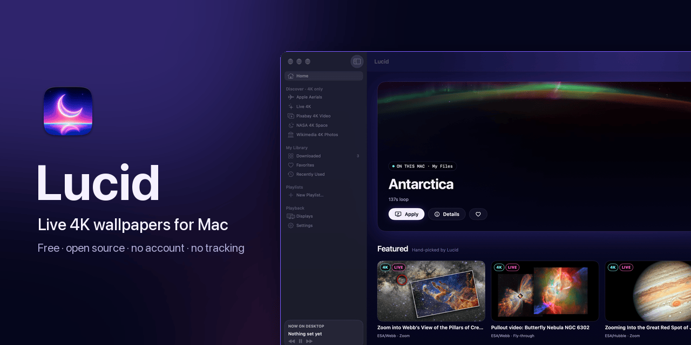
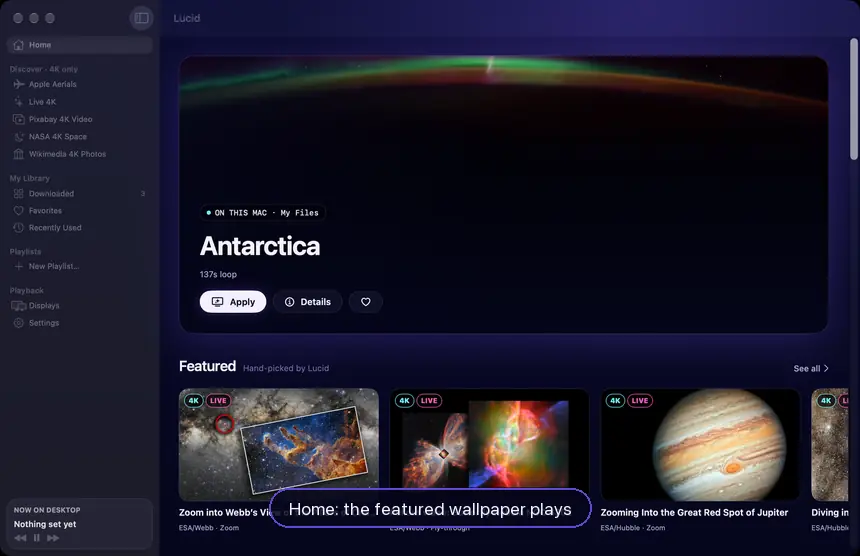
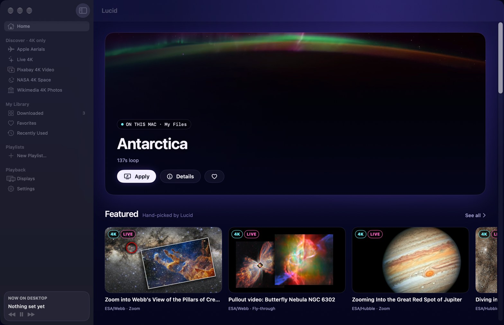
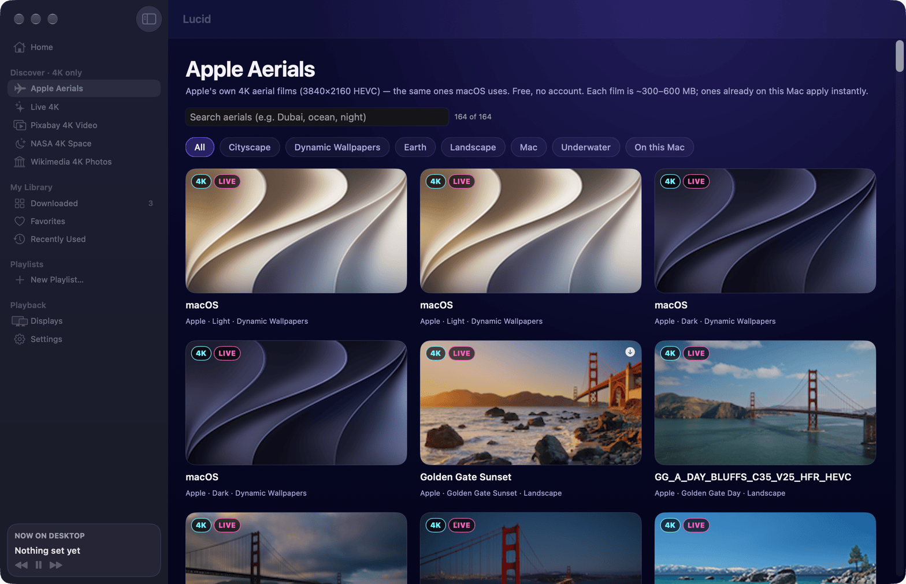
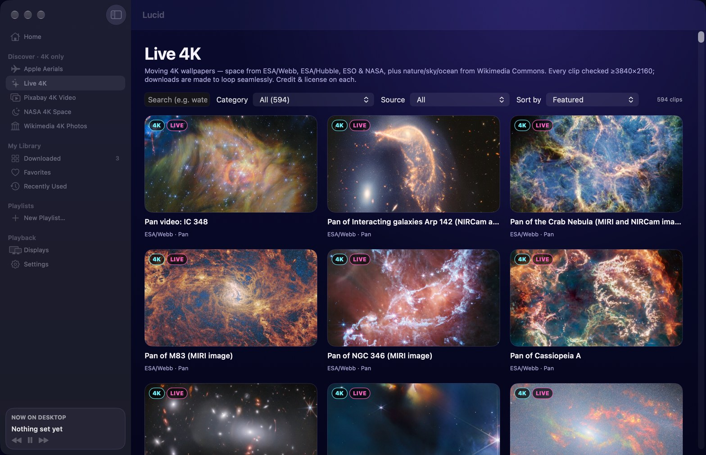
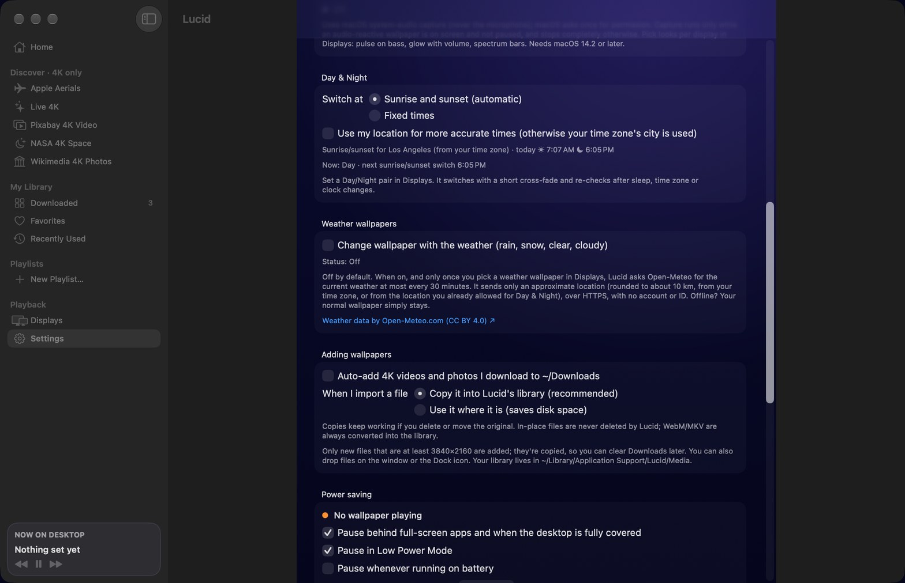
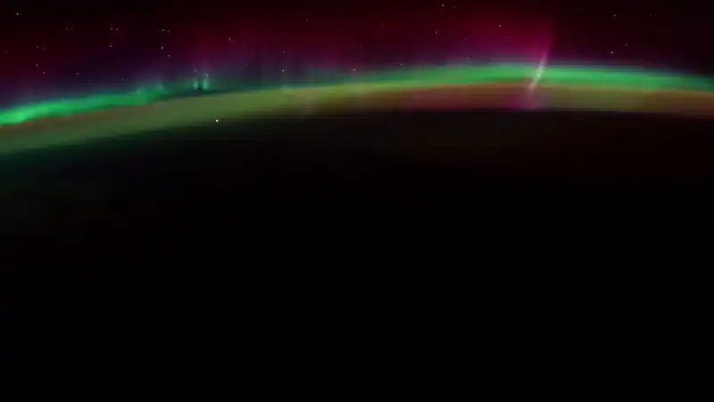

<p align="center">
  
</p>

<p align="center">
  <b>Live 4K wallpapers for your Mac.</b><br>
  Moving space, nature and ocean on every display. Free, native, no account, no tracking.
</p>

<p align="center">
  <a href="https://github.com/jedbrnth-eng/lucid-live-wallpaper/actions/workflows/ci.yml"></a>
  <a href="https://github.com/jedbrnth-eng/lucid-live-wallpaper/releases/latest"></a>
  
  
  
  <a href="LICENSE"></a>
</p>

<p align="center">
  <a href="https://lucid-wallpaper.vercel.app"><b>Website</b></a> ·
  <a href="#download-no-terminal-needed">Download</a> ·
  <a href="#whats-inside">Features</a> ·
  <a href="#what-lucid-cant-do">Limits</a> ·
  <a href="#bring-your-own">Bring your own</a> ·
  <a href="#where-the-wallpapers-come-from">Sources</a> ·
  <a href="#privacy">Privacy</a>
</p>

<p align="center">
  <a href="docs/demo.mp4"></a><br>
  <sub>Lucid 1.3: Home, a live preview, Apple Aerials, Live 4K, then Apply. Recorded from the app window. <a href="docs/demo.mp4">Watch the 1-minute tour</a>.</sub>
</p>

---

<p align="center">
  <a href="https://github.com/jedbrnth-eng/lucid-live-wallpaper/releases/latest/download/Lucid.zip"></a><br>
  <sub>Free · Apple Silicon (M1 or newer) · macOS 14+ · about 3 MB</sub>
</p>

## Download (no Terminal needed)

**Current release: [1.3.0](https://github.com/jedbrnth-eng/lucid-live-wallpaper/releases/tag/v1.3.0).** Lucid is a standalone app: install `Lucid.app`, with no companion app or older wallpaper app required. See [CHANGELOG.md](CHANGELOG.md) for the release history.

1. Click the big **Download Lucid for Mac** button above. A file called `Lucid.zip` lands in your Downloads folder.
2. Double-click `Lucid.zip`, then drag **Lucid.app** into your **Applications** folder.
3. Open Lucid. macOS will say it can't verify the app, because Lucid isn't notarized by Apple yet. Click **Done**, open **System Settings → Privacy & Security**, scroll down and click **Open Anyway** next to Lucid, then confirm. You only do this once.

Prefer one command instead? Use the installer below.

## Install in 10 seconds

Open **Terminal** (press `⌘ Space`, type `Terminal`, press Return), paste this line, and press Return:

```bash
curl -fsSL https://raw.githubusercontent.com/jedbrnth-eng/lucid-live-wallpaper/main/install.sh | bash
```

Lucid downloads, lands in your Applications folder and opens. From 1.3.0 on, the installer checks the download against the SHA-256 checksum published with the release (`Lucid.zip.sha256`) and stops if they differ. Lucid isn't notarized by Apple yet, so the installer clears macOS's download flag for you.

<sub>Needs an Apple Silicon Mac (M1 or newer) on macOS 14 Sonoma or later. Want to read the script first? It's [install.sh](install.sh), about 60 lines. The app is open source, so you can read every line it runs.</sub>

<details>
<summary><b>Other ways to install</b></summary>

<br>

**Skip the Open Anyway step.** If you downloaded the zip in a browser and prefer Terminal to System Settings, this clears macOS's download flag once:

```bash
xattr -dr com.apple.quarantine /Applications/Lucid.app
```

**Build it yourself** (needs Xcode Command Line Tools; the first optimized build can take several minutes):

```bash
xcode-select --install          # once
git clone https://github.com/jedbrnth-eng/lucid-live-wallpaper.git
cd lucid-live-wallpaper
./build.sh                      # creates build/Lucid.app
open build/Lucid.app
```

**Uninstall:**

```bash
rm -rf /Applications/Lucid.app "$HOME/Library/Application Support/Lucid"
```

</details>

## Take a look

<p align="center">
  <br>
  <sub>Home: the featured wallpaper plays, rows scroll sideways.</sub>
</p>

<p align="center">
  <br>
  <sub>Apple Aerials: the films already on your Mac apply instantly.</sub>
</p>

<p align="center">
  <br>
  <sub>Live 4K: 594 curated clips, by category.</sub>
</p>

<p align="center">
  <br>
  <sub>Settings: Day &amp; Night, optional weather, how files are added, and smart pausing.</sub>
</p>

<p align="center">
  <a href="docs/aurora.mp4"></a><br>
  <sub>A live aurora wallpaper on the desktop. <a href="docs/aurora.mp4">Watch in full HD</a>.</sub>
</p>

## What's inside

| Feature | |
|---|---|
| **Home + live previews** | Opens on a featured wallpaper that plays, then rows to scroll sideways: recently used, most used (counted only on your Mac), hand-picked featured clips, favorites, new, and one row per category. Hover a card and the clip plays, muted, so you see it as it will look. Only clips already on your Mac preview, from a small cached copy; at most 3 play at once, and all stop when Lucid is in the background or your Mac is saving power. Reduce Motion shows still posters. |
| **590+ live 4K clips** | 594 curated moving wallpapers from ESA/Webb, ESA/Hubble, ESO, NASA and Wikimedia Commons. Browse by category (Space, Nature & Landscapes, Ocean & Beaches, Sky & Time-lapse, Cities). Every clip is verified at 3840×2160 or larger and turned into a seamless loop. |
| **Apple Aerials** | Apple's own 4K aerial films. The ones already on your Mac apply instantly; others download from Apple when you pick them. |
| **Your own files** | Drag in your own videos and photos, or whole folders. Copy them in or use them where they are. Per wallpaper: fill, fit or stretch, which part to keep when cropping, and playback speed. Damaged or non-media files are refused with a clear message. Anything below 4K is flagged. |
| **Audio reactive** | Optional: wallpapers pulse on the bass, glow with the volume or show spectrum bars, driven by the sound your Mac plays (never the microphone). Off by default. |
| **Day & Night** | One wallpaper by day, another at night, switching at sunrise and sunset (or at fixed times) with a soft cross-fade. Optional dawn and dusk wallpapers for the twilight in between. |
| **Playlists** | Rotate on a timer or at times of day you choose, on all displays or one display each. Shuffle never repeats an item until all have played, and playback picks up where it was after a restart. |
| **Smart pausing** | Pauses behind full-screen apps, when the screen locks or the display sleeps, in Low Power Mode, below a battery level you pick, when your Mac runs hot, or (optionally) when the CPU is busy. A status line says why. After a long pause the players are closed to free memory. |
| **Shortcuts** | Optional global shortcuts for pause/resume, next and previous (for example ⌃⌥⌘P, ⌃⌥⌘→, ⌃⌥⌘←). No Accessibility permission needed. |
| **Weather and update check** | Both optional and off by default: a different wallpaper when it rains, snows, is clear or cloudy, and a once-a-day check that shows a link when a new release is out (nothing installs itself). |
| **Stills** | NASA 4K Space and Wikimedia 4K Photos, with the license shown on every item. |
| **Every display** | A different wallpaper on each monitor, favorites and open at login. Switch to a recent wallpaper straight from the menu bar. |
| **Private by design** | No account, no analytics, no telemetry. Native SwiftUI and AppKit, no dependencies. |

## Use it

1. Open Lucid. It also lives in your menu bar.
2. On **Home** (or in **Discover**), hover a wallpaper to preview it and click **Apply**.
3. Have more than one screen? Open a wallpaper and use **Set on Display**.

## Bring your own

Three ways, pick whichever is easiest:

- **Drag and drop** videos, photos or whole folders onto the Lucid window or its Dock icon.
- Click **Import…** on the **Downloaded** page.
- Drop files straight into `~/Library/Application Support/Lucid/Media`. They appear on their own within seconds.

MP4 and MOV work as they are. WebM, MKV and similar formats are converted to HEVC when [ffmpeg](https://ffmpeg.org) is installed (`brew install ffmpeg`). Your files show up under **Downloaded → My Files**.

- **Copy or use in place.** By default Lucid copies a file into its library, so it keeps working if you delete the original. In **Settings → Adding wallpapers** you can choose *Use it where it is* instead; Lucid never deletes those files.
- **Per wallpaper:** open a wallpaper in your library to pick *Fill (crop)*, *Fit (letterbox)* or *Stretch*, which part to keep when cropping (center, top, bottom, left, right) and its playback speed.
- Lucid checks each file before adding it: empty files, programs or scripts renamed to `.mp4`, files over 16 GB and damaged videos or photos are refused with a short reason. Folder imports skip hidden files and links that point outside the folder.

## Playlists and shortcuts

Make a playlist from any wallpaper's **Add to playlist** button, then press **Play Playlist** (all displays) or **Play on** a single display. Each playlist changes on a timer (5 minutes to daily) or at times you type, such as `07:00, 12:30, 19:00`. Shuffle plays every item once before repeating and never shows the same one twice in a row. Changes cross-fade, and after a restart the playlist continues where it was.

Turn on **Settings → Keyboard shortcuts** for global pause/resume, next and previous. Lucid registers only those exact key combinations with macOS (no Accessibility or Input Monitoring permission), and marks a shortcut another app already uses instead of taking it. The menu bar shows the same controls plus a status line such as *Playing* or *Paused: full-screen app*.

## Audio reactive

Turn on **Settings → Audio reactive**, then pick looks per display in **Displays → Audio**: *Pulse on bass*, *Glow with volume*, *Spectrum bars*. These work on any wallpaper, videos and photos included.

- Lucid listens to the sound your Mac **plays**, using macOS system-audio capture (a Core Audio tap). It never uses the microphone. macOS asks once for permission (*System Audio Recording*).
- Sound is analysed on your Mac (an FFT into bass, mid and treble plus 64 bands per channel) and is never recorded or sent anywhere.
- Capture runs only while an audio-reactive wallpaper is on screen and playing. It stops completely when the wallpaper is paused, covered, locked, asleep, on battery or in Low Power Mode (following your power settings), or when you turn the feature off.
- Needs macOS 14.2 or later. If you hear music but nothing moves, check **System Settings → Privacy & Security → Screen & System Audio Recording**.

## Day & Night

In **Displays**, click **Day/Night…** for one display, or **Day/Night for All…**, and pick a day and a night wallpaper. Lucid switches at sunrise and sunset with a short cross-fade.

- **Automatic** times come from your time zone's city (for example Bangkok), with no permission needed. Turn on **Use my location** in Settings for more accurate times. The location stays on your Mac.
- Or choose **Fixed times** (for example day from 07:00, night from 19:00).
- Lucid checks again after sleep, a time zone change or a clock change, and remembers your pairs after a restart. Near the poles, midnight sun and polar night are handled.
- Optional **dawn** and **dusk** wallpapers: dawn runs from first light (civil dawn, sun 6° below the horizon) until the sun is 6° up; dusk from the evening golden hour until last light. With fixed times, dawn is the first hour of the day and dusk the last. Pairs set in 1.2.0 work exactly as before.
- Sunrise and sunset use NOAA's solar equations.

## Weather

Turn on **Settings → Weather wallpapers**, then in **Displays → Weather…** pick a wallpaper for rain, snow, clear or cloudy weather. Conditions without one keep your normal wallpaper.

- Lucid asks [Open-Meteo](https://open-meteo.com) (free, no key, no account) for the current weather at most every 30 minutes, and only while the feature is on and at least one weather wallpaper is set.
- It sends only an approximate location: your time zone's city, or the location you already allowed for Day & Night, rounded to one decimal place (about 10 km). Lucid never asks for location permission for weather.
- Offline or no answer? Nothing changes. A reading older than 3 hours is ignored.
- Weather data by Open-Meteo.com, [CC BY 4.0](https://open-meteo.com/en/licence).

## What Lucid can't do

Straight answers, so you don't have to find out after installing:

- **No moving Lock Screen.** macOS has no public way for apps to put video on the Lock Screen, so Lucid doesn't. A screen saver version is possible but not shipped yet: see [docs/lock-screen-feasibility.md](docs/lock-screen-feasibility.md).
- **No Wallpaper Engine files.** Wallpaper Engine projects (scenes, web and application wallpapers, `.pkg` files) don't open. Lucid plays ordinary video and photo files.
- **Not notarized by Apple (yet).** The first launch needs the one-time **Open Anyway** step above, or the installer script.
- **Apple Silicon only.** Lucid is built for M1 or newer on macOS 14 Sonoma or later. Intel Macs aren't supported.
- Global shortcuts come from a fixed list of combinations (no custom recorder yet).
- Converting WebM/MKV needs ffmpeg; MP4 and MOV don't.

## Where the wallpapers come from

**This repo contains no wallpaper media.** `catalog.json` is a list of links and credits. The app downloads clips from their original sources onto your Mac, and shows the credit and license for every item.

The wallpapers belong to their creators, each under its own license, and the app shows the credit and license for every item:
- **NASA:** generally public domain. Credit NASA, and don't imply endorsement.
- **ESA/Webb, ESA/Hubble, ESO:** CC BY 4.0. Their soundtrack music is not covered by that license, so Lucid removes the audio. ESO footage of identifiable people is not for commercial use.
- **Wikimedia Commons:** per file (CC0, CC BY, CC BY-SA…). Credit the author if you share a file.
- **Apple Aerials:** Apple content that ships with macOS, for personal use on your Mac only. It is never bundled or redistributed.
- **Pixabay:** free to use, but files must not be redistributed as-is.

Loops are modified (cross-faded, re-encoded) copies for **personal use on your own Mac**. If you republish any of them, follow each item's license, including attribution and share-alike. Full research notes: [`SOURCES.md`](SOURCES.md).

## How it works

Each display gets a borderless window at desktop level, above the system wallpaper and below the desktop icons, holding a muted, hardware-decoded looping `AVQueuePlayer` (or a still image when an audio-reactive look or a Day/Night pair needs one). Changing wallpaper cross-fades the new window over the old one, then releases the old player. A frame from the video is also set as the real desktop picture, so Mission Control and other Spaces show a matching still.
Data lives in `~/Library/Application Support/Lucid/`.

## Project layout

```
Sources/Lucid/
├── App/        entry point, app delegate, menu bar, file import, dev check
├── Audio/      system-audio capture, FFT analyser, audio-reactive looks
├── Core/       models, paths, preferences, Keychain
├── Content/    content providers and the curated Live 4K catalog
├── DayNight/   sunrise/sunset (NOAA) and the day/night schedule
├── Engine/     per-display wallpaper windows, smart pausing and the downloader
├── Hotkeys/    global shortcuts (Carbon RegisterEventHotKey)
├── Media/      import rules, transcoding and seamless loop maker
├── Store/      app state shared by the views, playlist scheduling
├── Update/     optional update check
├── Weather/    optional weather wallpapers (Open-Meteo)
└── Views/      SwiftUI screens and components
Tests/          unit tests (./test.sh) and saved-data / API fixtures
docs/           security review, lock-screen feasibility, media
packaging/      draft Homebrew cask (not published)
tools/          catalog builder and its tests
```

## Privacy

No account, no analytics, no telemetry.

- **Audio reactive** (off by default): uses macOS system-audio capture, never the microphone. Sound is analysed on your Mac and never recorded or sent.
- **Location** (off by default, Day & Night): used to work out sunrise and sunset and stored rounded to about 1 km on your Mac. It is not sent anywhere, except that if you also turn on Weather wallpapers, a further rounded version (about 10 km) goes to Open-Meteo.
- **Weather** (off by default): one HTTPS request to Open-Meteo at most every 30 minutes, with only rounded coordinates. Without location permission, the coordinates come from your time zone's city.
- **Update check** (off by default, Settings → General): one anonymous HTTPS request a day to GitHub's public releases API. If a newer version exists, Settings shows a link to its release page. Nothing is downloaded or installed automatically.
- **Most used** on the Home page: a count of how often you chose each wallpaper, saved in `usage.json` in Lucid's folder. It is never sent anywhere. Previews are made from files already on your Mac and cached in Lucid's `Previews` folder.
- Otherwise the app only contacts the content sources above (NASA, ESA, ESO, Wikimedia Commons, Apple's servers for Aerial films you choose, and Pixabay if you add a key) to browse and download what you choose.

Security notes and the threat model: [docs/security-review.md](docs/security-review.md).

## Test

The fast, offline checks do not need a built app:

```bash
./test.sh                                        # unit tests: pausing, import rules, playlists, shortcuts, sun/twilight, weather, update check, saved data, Home rows, usage counter, preview limits
python3 -m unittest tools/test_build_catalog.py  # catalog-builder tests
```

These next checks use live services and are not part of the offline test suite:

```bash
./build.sh
./selftest.sh                                    # launches build/Lucid.app; queries wallpaper sources
python3 tools/build_catalog.py catalog.json      # rebuilds the catalog from live sources (slow)
```

`selftest.sh` writes `selftest.json` in `~/Library/Application Support/Lucid/`. Inspect its JSON results: the wrapper's exit code alone does not prove every source passed. It uses the normal Lucid app environment, so don't run it alongside your everyday copy as if it were an isolated unit test. The catalog-builder command rewrites `catalog.json`; review the diff before committing it.

## Credits

- Sunrise and sunset: NOAA Global Monitoring Laboratory's solar calculator equations (public domain).
- Weather data: [Open-Meteo.com](https://open-meteo.com), CC BY 4.0.

## Contributing

Issues and pull requests are welcome. See [CONTRIBUTING.md](CONTRIBUTING.md). Release history is in [CHANGELOG.md](CHANGELOG.md).

## License

Lucid is free software under the [GNU GPL v3.0](LICENSE), © 2026 Jed Brown. You can use it, study it, change it and share it. If you pass it on, modified or not, you must keep the copyright and credit to Jed Brown, release your full source under GPL-3.0 too, and say what you changed. Wallpaper content stays under its creators' licenses, as above.

Want to improve it? Please send your changes here as a pull request instead of making a separate copy ([CONTRIBUTING.md](CONTRIBUTING.md)). The Lucid name and icon are not covered by the license, so a fork needs its own.

*Not affiliated with or endorsed by Apple, NASA, ESA, ESO, Wikimedia or Pixabay.*
